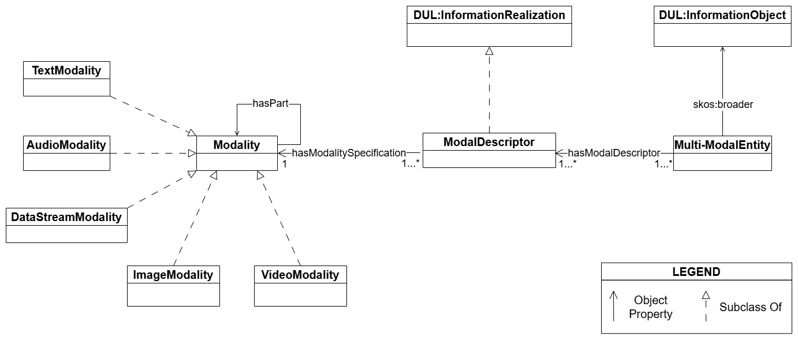

[![CC BY-SA 4.0][cc-by-sa-shield]][cc-by-sa]

[cc-by-sa]: http://creativecommons.org/licenses/by-sa/4.0/
[cc-by-sa-shield]: https://img.shields.io/badge/License-CC%20BY--SA%204.0-lightgrey.svg

# The Multi-Modal Pattern: Decoupling Modalities for Unified Representation in Multi-Modal Knowledge Graphs

This repository contains the conceptual model and the application and alignment files for the multi-modal ontology design pattern described in the paper *"The Multi-Modal Pattern: Decoupling Modalities
for Unified Representation in Multi-Modal Knowledge Graphs"*.

**Project Webpage:** [**https://ida-fbk.github.io/MultiModalPatternWeb/**](https://ida-fbk.github.io/MultiModalPatternWeb/)

## Multi-Modal ODP conceptual model

We propose a Multi-Modal Ontology Design
Pattern (ODP) that provides a domain-agnostic structural backbone for multi-modal representation by separating (i) a multi-
modal entity as an information object, (ii) its concrete digital realisations as modal descriptors, and (iii) reusable modality specifications, including support for modality composition.
The ODP's goal is to represent information entities with their associated modalities, of diverse nature, and the corresponding relationships between them
(**AIM1**) while providing flexibility and extensibility to seamlessly incorporate new
modalities and adapt to changes in existing ones (**AIM2**). These  two aims[^1] determine
the requirements underlying the pattern’s design: **AIM1** identifies the functional requirements that the pattern should satisfy and that we represent in the four competency
questions (CQs):

- CQ1: What are the modalities that contribute to the representation of a data resource?
- CQ2: Which modalities, if any, subsume or contain other modalities?
- CQ3: What are the relationships between a resource and its associated
modalities?
- CQ4: What is the format or structure associated with a given resource?

**AIM2** relates to the set of (non-functional) requirements:

1. The pattern should enable the integration of heterogeneous modalities that collectively describe the same real-world entities.
2. The pattern should establish a clear and consistent ontological commitment to the concept of modality
3. The pattern should maintain abstraction at a level that ensures domain and task independence.
4. The pattern should facilitate usability and extensibility, allowing practitioners to incorporate novel modalities and define inter-modality relationships.
5. The pattern should support modularity to accommodate evolving modelling needs and promote interoperability.

## Multi-Modal ODP Applications
- FuS-KG: A Multi-Modal Knowledge Graph Supporting
Personalized Health [[WEBSITE]](https://horus-ai.fbk.eu/fuskg/) [[REPO]](https://github.com/IDA-FBK/FuS-KG) [[DIAGRAMS]](/diagrams/applications_and_alignments/applications/FuS-KG/)
 

## Multi-Modal ODP Alignments
- The Multimodal Description of Social Concepts Ontology (MUSCO): [[REPO]](https://github.com/delfimpandiani/musco) [[DIAGRAMS]](/diagrams/applications_and_alignments/alignments/MUSCO/) [[ALIGNED ONTOLOGY]](/ontology/alignments/musco_alignment.ttl)
- The Ontology for Multimodal Knowledge Graphs for Data Spaces: [[DIAGRAMS]](/diagrams/applications_and_alignments/alignments/MMKG-Dataspaces/) [[ALIGNED ONTOLOGY]](ontology/alignments/dataspaces_alignment.ttl)
- The Polifonia Ontology Network (PON) - CoMeta: [[REPO]](https://github.com/polifonia-project/cometa-ontology/) [[DIAGRAMS]](/diagrams/applications_and_alignments/alignments/Cometa/) [[ALIGNED ONTOLOGY]](ontology/alignments/cometa_alignment.ttl)

> [!NOTE]
> Opening alignments files in Protégé will ask to import the [Multi-Modal ODP](https://github.com/IDA-FBK/MultiModalPattern/blob/main/ontology/multi-modal_odp/multi-modal_odp.ttl) file if not found.

[^1]: for further details, refer to Sections 4 and 5 of the paper.

## Authors
- Gianluca Apriceno: apriceno@fbk.eu
- Valentina Tamma: V.Tamma@liverpool.ac.uk
- Tania Bailoni: tbailoni@fbk.eu
- Jacopo de Berardinis: jacodb@liverpool.ac.uk 
- Mauro Dragoni: dragoni@fbk.eu

## License
This work is licensed under a
[Creative Commons Attribution-ShareAlike 4.0 International License][cc-by-sa].

[![CC BY-SA 4.0][cc-by-sa-image]][cc-by-sa]

[cc-by-sa-image]: https://licensebuttons.net/l/by-sa/4.0/88x31.png
